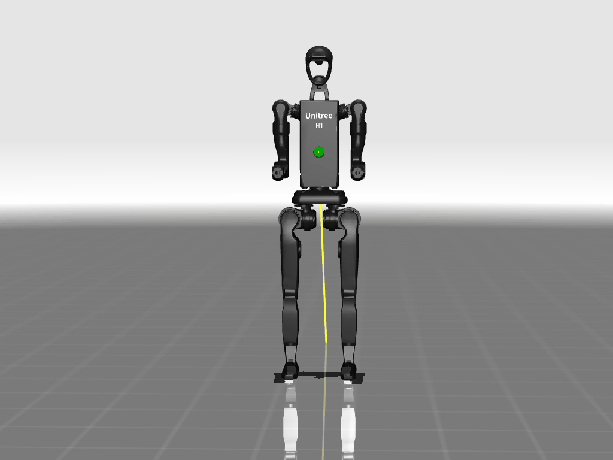
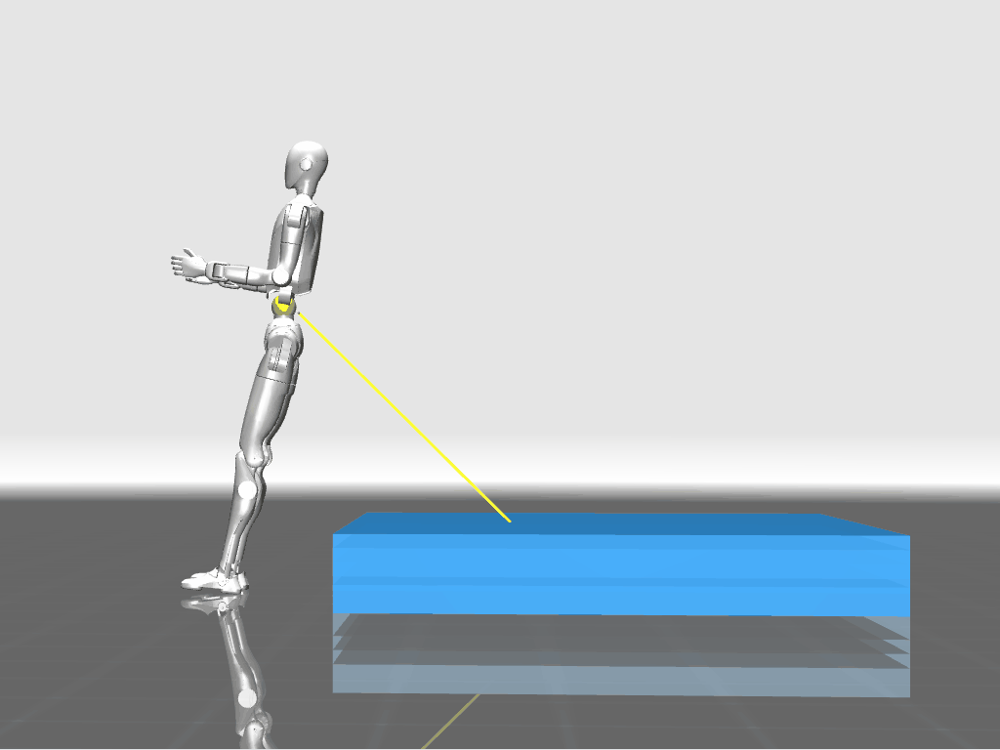
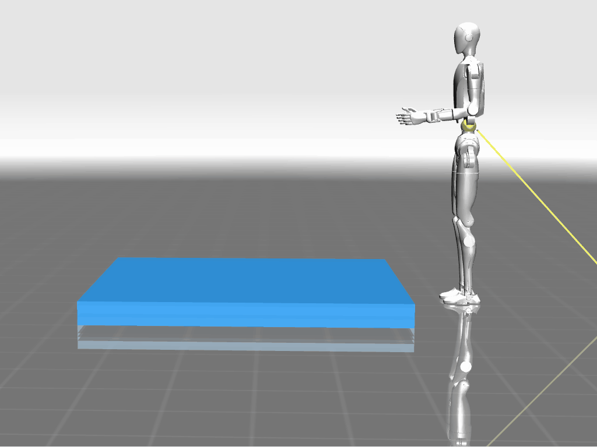
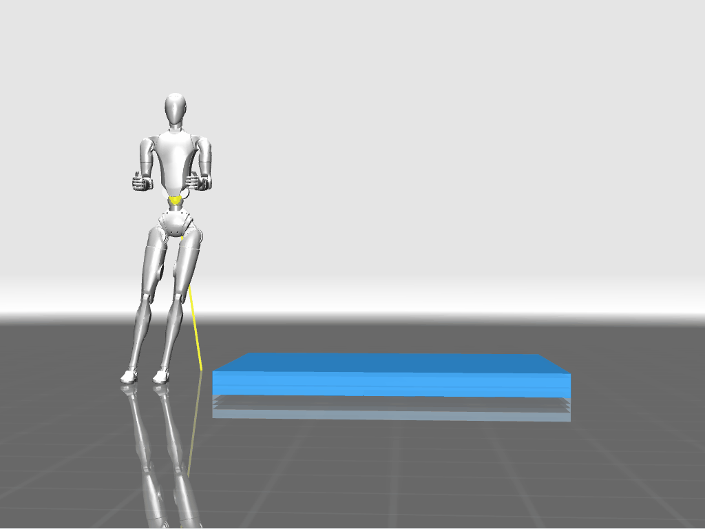
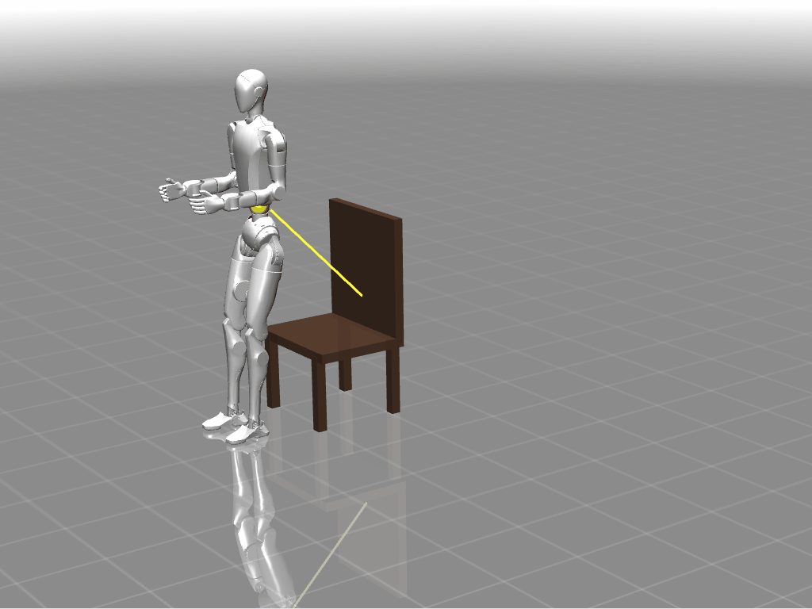
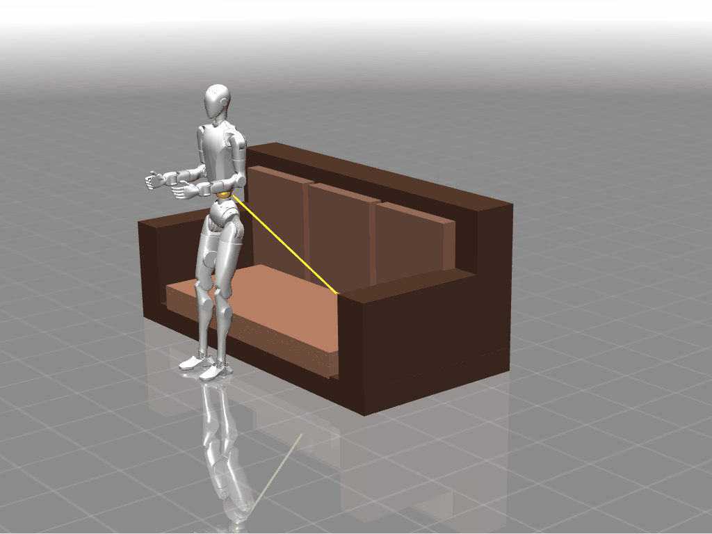
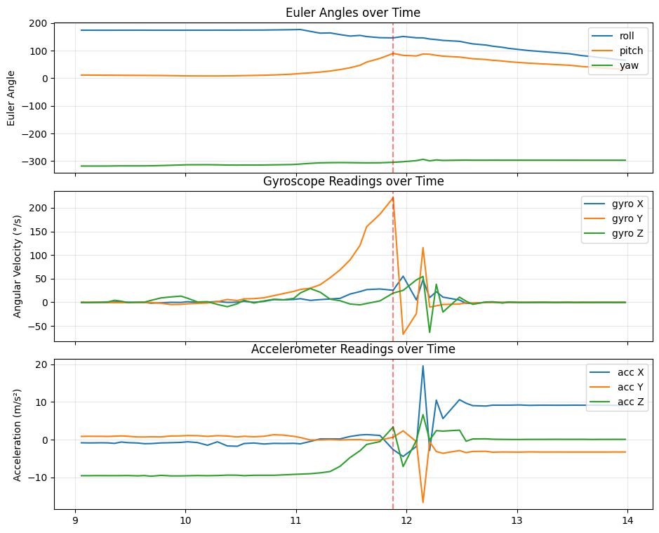
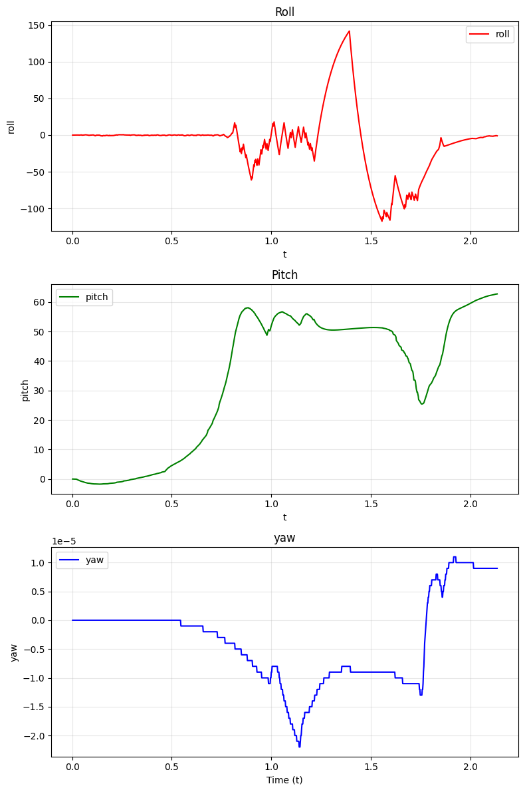

# LSTM-Based Fall Prediction for Humanoid Robots in Unitree MuJoCo

**Sensor-based temporal classification using simulated IMU and time-of-flight measurements.**

This research project investigates whether an LSTM can recognize developing humanoid falls from recent sensor history. The standing experiment combines a Unitree H1-2 model in MuJoCo, randomized torso disturbances, and a TensorFlow/Keras classifier. Separate H2 experiments explore directional falls, cushions, and furniture interactions. Anticipating falls could provide time for protective action; this repository studies prediction timing in simulation and does not demonstrate fall prevention or validated pre-impact intervention.

**Reported evaluation:** 200 simulated trials, with a mean prediction response time of approximately **252 ms** into the falling sequence. This is elapsed simulation time to a prediction event, not computational inference latency.

[Overview](#overview) · [Demonstrations](#simulation-demonstrations) · [Methodology](#methodology) · [Results](#experimental-results) · [Physical Airbag Deployment](#physical-airbag-deployment) · [Discussion](#discussion) · [Task Files](#task-files) · [Repository Structure](#repository-structure) · [Future Work](#future-work-imu-orientation-estimation-with-an-extended-kalman-filter) · [References](#acknowledgments-and-references)

## Overview

External disturbances, collisions, and interactions with surrounding objects can destabilize humanoid robots. Impact-based detection may arrive too late for a useful response. This project explores temporal sensor patterns as an alternative to relying on a single inertial threshold.

Acceleration and angular velocity characterize translational and rotational motion; simulated ToF distance adds information about separation from surfaces. An LSTM processes their recent evolution, while MuJoCo provides a configurable environment for repeated disturbance episodes and sensor analysis.

The work is an experimental feasibility study encompassing data collection, sliding-window classification, timing analysis, and additional physical scenarios. Prediction during a falling trajectory is distinct from prediction before first impact. The current study does not establish impact-relative warning time, held-out classification accuracy, physical robot performance, or a successful protective intervention.

## Simulation Demonstrations

These recordings illustrate simulation scenarios, rather than independently establishing model performance or collision avoidance. The H2 demonstrations are separate from the standing H1-2 timing evaluation.

### 1. Humanoid Robot Simulation



*Standing H1-2 experiment: robot motion in the disturbance-based simulation.*

### 2. External Disturbance and Falling Scenarios

| Backward fall | Forward fall with arm movement |
| --- | --- |
|  |  |
| H2 backward falling scenario. | H2 forward fall with a scripted arm response. |



*H2 lateral falling scenario with arm movement. Some experimental responses directly set joint positions; they are not validated recovery controllers.*

### 3. Environmental Interaction

| Chair scenario | Sofa scenario |
| --- | --- |
|  |  |
| Seated H2 interaction with a disturbed chair. | H2 seating and contact behavior on a sofa. |

## Methodology

**Simulation → Disturbance generation → Sensor acquisition → Feature extraction → Sliding window → LSTM classification → Prediction evaluation**

### A. Simulation environment

The standing workflow selects `h1_2` in [config.py](simulate_python/task_1_standing/config.py), loading [scene.xml](unitree_robots/h1_2/scene.xml) and its handless H1-2 model. Explicit inertial masses in [h1_2_handless.xml](unitree_robots/h1_2/h1_2_handless.xml) sum to **66.984 kg**, consistent with the reported approximately 66.98 kg. The reported setup describes an approximately 1.5 m humanoid; that height has not been independently verified from model geometry.

The cushion and furniture tasks use the shared [H2 model](unitree_robots/H2_URDF/shared/H2_modified_high_damping.xml). These motion/contact experiments are not integrated with the standing LSTM as a closed-loop response system.

### B. Disturbance generation

The reported protocol applies horizontal disturbances to the torso near the center of mass, with a nominal force range of 700–1500 N and duration of 150 ms. The standing collector and batch predictor target `torso_link`. They sample two horizontal components independently from `uniform(-1, 1)`, rounded to three decimals, with zero vertical component. A scalar from `randint(700, 1500)` (700–1499) multiplies this vector.

**Implementation qualifications:** the vector is not normalized, so the actual force magnitude is not constrained to the nominal scalar range. The scripts assign force during the first 150 ms but do not explicitly clear `xfrc_applied` afterward; the force therefore persists until reset. Interactive inference instead uses a 200 ms assignment condition. These are not verified finite 150 ms pulses. Randomized directions and scales generate varied trajectories, but exact protocol reproduction requires resolving these differences.

### C. Sensor acquisition

The collector records one sample per physics step, with CSV columns:

```text
t,acc_x,acc_y,acc_z,gyro_x,gyro_y,gyro_z,tof
```

| Measurement | Unit | Implementation and role |
| --- | --- | --- |
| Three-axis acceleration | m/s² | `imu_acc` accelerometer at the IMU site; characterizes inertial motion. |
| Three-axis angular velocity | rad/s | `imu_gyro` gyroscope; characterizes rotation. |
| ToF distance | m | `tof` MuJoCo rangefinder at `tof_origin`; measures distance along its ray to a surface, rather than guaranteed vertical ground clearance. |

The ToF channel is a simulated range measurement, not a model of physical sensor electronics or noise.

### D. Feature extraction

Training and online inference reduce the IMU axes to Euclidean magnitudes:

```text
a_mag    = sqrt(ax² + ay² + az²)
gyro_mag = sqrt(wx² + wy² + wz²)
features = [ToF, a_mag, gyro_mag]
```

Classification uses the temporal variation of these three features. Magnitudes discard axis direction. The training notebook implements no additional features or explicit feature normalization.

### E. Sliding-window input and timing

Each input has shape **(10, 3)**: ten consecutive observations and three features. Standing scripts override the configured timestep to **0.002 s**; supplied CSV timestamps confirm 2 ms spacing.

- Ten samples span **18 ms between the first and last timestamps**, or ten sampling periods totaling 20 ms. This explains the reported 20 ms time unit; it is not a 200 ms window.
- Training windows advance by one sample (2 ms), creating overlapping sequences.
- Online inference appends a new feature vector to `deque(maxlen=10)` every step, dropping the oldest when full.
- The `counter == 20` condition checks the classifier every 21 steps, approximately **42 ms of simulation time**, until the first class-1 event. Prediction cadence differs from training-window stride.

The online buffer is not explicitly cleared at episode reset. Adjacent episodes briefly share the buffer, although the first scheduled prediction occurs after ten new samples have arrived.

### F. Prediction model and training

Both [training.ipynb](simulate_python/task_1_standing/training.ipynb) and the saved [0210.keras](simulate_python/task_1_standing/0210.keras) configuration specify:

| Component | Implemented configuration |
| --- | --- |
| Framework | TensorFlow/Keras |
| Input | `(batch, 10, 3)` |
| Recurrent layer | One LSTM, 16 hidden units, `return_sequences=False`, no bias |
| Output | Dense layer, two softmax outputs, no bias |
| Decision | `argmax`; class 1 triggers the falling flag |
| Loss / optimizer | Sparse categorical cross-entropy / Adam |
| Training | 10 epochs, batch size 256 |

The notebook reads `csv/0.csv` through `csv/1999.csv`, retains the first 210 rows per episode, and constructs 200 windows per episode. Labels are **time-based proxies**: class 1 if the window's starting timestamp exceeds 0.2 s, otherwise class 0. They are not independently annotated balance-loss or impact labels.

There is no validation split or independent test set in the notebook. Its inference example uses episode 1237, which is also included in training. A saved model is provided, but this workflow does not establish held-out generalization or classification accuracy. Random seeds and dependency versions are not pinned.

### G. Prediction evaluation

The batch predictor runs 200 episodes and records the first class-1 prediction time. An episode ends when pelvis height is at most 0.25 m or simulation time reaches 10 s. Recorded `duration` is this endpoint, not a measured first-contact timestamp.

The exporter stores prediction times and durations in separate lists, assuming one prediction per episode when combining them. Trials without predictions are not explicitly represented. Robust evaluation should retain episode IDs, non-trigger outcomes, and independently measured impact times.

## Experimental Results

The supplied experimental report's statistics are reproduced exactly by the 200 rows in [time_data.csv](simulate_python/task_1_standing/time_data.csv):

| Metric | Reported value |
| --- | --- |
| Number of evaluated trials | 200 |
| Mean fall duration | 0.66171 s |
| Mean prediction response time | 0.25169 s |
| Trials with response time below 20% of fall duration | 7 |
| Trials with response time below 25% of fall duration | 18 |
| Trials with response time above 70% of fall duration | 1 |

The mean prediction event occurs approximately **252 ms** into the simulated sequence. Here, “fall duration” follows the report's terminology; the current script uses the pelvis-height/timeout endpoint described above. These values measure prediction timing, not inference runtime, accuracy, sensitivity, specificity, or false-positive rate. The chair, sofa, and cushion demonstrations are not established as part of this 200-trial dataset.

### Prediction Response Time vs. Fall Duration


*Blue points show fall duration; red points show prediction response time, both in seconds. The horizontal axis indexes individual trials.*

Prediction events generally occur earlier than reported fall completion, while trajectory durations vary substantially. This comparison does not establish that every fall was correctly classified or that prediction preceded first impact.

### Normalized Prediction Timing Distribution


```text
normalized timing = prediction response time / total fall duration
```

*Smaller ratios indicate earlier predictions relative to the full trajectory. Horizontal values are fractions, approximately 0.1–0.7, despite the percent sign in the existing plot label: 0.2 corresponds to 20%.*

Seven trials fall below 0.20, eighteen below 0.25, and one exceeds 0.70. Very early events raise the possibility of premature triggering; late events may leave insufficient time for protective action. These are timing-based concerns, not confirmed false-positive or false-negative measurements. The distribution is not a classification-accuracy measure.

## Physical Airbag Deployment

The [physical experiment video](img/humanoid_air_bag_experiment.mp4) shows a humanoid falling backward and a protective airbag deploying during the fall. It complements the simulation results with a physical demonstration of the algorithm's fall-detection and deployment sequence. The on-screen annotations provide the event timings below; this demonstration offers qualitative evidence of physical operation rather than a classification-accuracy measurement.

| Demo video | Translation of captions |
| --- | --- |
| <video src="img/humanoid_air_bag_experiment.mp4" controls width="420" aria-label="Physical humanoid fall and airbag deployment experiment"></video><br>[Watch or download the video](img/humanoid_air_bag_experiment.mp4) | **Fall onset → airbag deployment:** 662 ms (662 ms since fall onset).<br>**Airbag fully inflated:** 91 ms after deployment (753 ms since fall onset).<br>The moving arrow marks the current stage; the second timing column shows elapsed time since fall onset. |

## Discussion

The results support investigating sensor-based temporal classification for developing falls in simulation. Different disturbance directions and motion patterns produce varying trajectory durations and prediction timings. Inertial magnitudes and range history provide complementary signals, but their individual contributions have not been established through an ablation study.

Earlier warnings may provide more response time while increasing the risk of premature triggering. Time-based labels, lack of independent validation, and uncertain alignment with first impact limit conclusions about this trade-off. Non-falling motion, matched disturbance comparisons, and impact-relative timing are needed before assessing safety-critical suitability. Scripted H2 motions do not establish model-triggered protection.

## Task Files

Paths below are relative to the repository root.

### Task 1: Standing and fall prediction

- [simulate_python/task_1_standing/h1_2_sim.py](simulate_python/task_1_standing/h1_2_sim.py): simulation viewer.
- [simulate_python/task_1_standing/h1_2_sim_headless.py](simulate_python/task_1_standing/h1_2_sim_headless.py): sensor data collection.
- [simulate_python/task_1_standing/h1_2_sim_keras.py](simulate_python/task_1_standing/h1_2_sim_keras.py): interactive Keras prediction.
- [simulate_python/task_1_standing/h1_2_sim_headless_keras.py](simulate_python/task_1_standing/h1_2_sim_headless_keras.py): batch prediction and timing export.
- [simulate_python/task_1_standing/keras_test.py](simulate_python/task_1_standing/keras_test.py): offline inference example.
- [simulate_python/task_1_standing/config.py](simulate_python/task_1_standing/config.py): simulation configuration.
- [simulate_python/task_1_standing/unitree_sdk2py_bridge.py](simulate_python/task_1_standing/unitree_sdk2py_bridge.py): simulator/SDK bridge.

### Task 2: Directional falls onto cushions

- [unitree_robots/H2_URDF/task_2_cushion/start_living_room.py](unitree_robots/H2_URDF/task_2_cushion/start_living_room.py): cushion fall scenarios.
- [unitree_robots/H2_URDF/task_2_cushion/starter_helper.py](unitree_robots/H2_URDF/task_2_cushion/starter_helper.py): task helper utilities.
- [unitree_robots/H2_URDF/task_2_cushion/material_validation/test.py](unitree_robots/H2_URDF/task_2_cushion/material_validation/test.py): supporting ball/cushion experiment.

### Task 3: Chair and sofa interactions

- [unitree_robots/H2_URDF/task_3_furniture/chair_scene.py](unitree_robots/H2_URDF/task_3_furniture/chair_scene.py): chair disturbance scenario.
- [unitree_robots/H2_URDF/task_3_furniture/sofa_scene.py](unitree_robots/H2_URDF/task_3_furniture/sofa_scene.py): sofa interaction scenario.
- [unitree_robots/H2_URDF/task_3_furniture/starter_helper.py](unitree_robots/H2_URDF/task_3_furniture/starter_helper.py): task helper utilities.

Shared H2 utilities are in [unitree_robots/H2_URDF/shared/starter_helper.py](unitree_robots/H2_URDF/shared/starter_helper.py).

### Visualization, training, and model files

- **Standing visualization:** [visualization.ipynb](simulate_python/task_1_standing/visualization.ipynb) and [time_data_processing.ipynb](simulate_python/task_1_standing/time_data_processing.ipynb) in `simulate_python/task_1_standing/`.
- **Cushion visualization:** [visualization.ipynb](unitree_robots/H2_URDF/task_2_cushion/visualization.ipynb) in `unitree_robots/H2_URDF/task_2_cushion/`, plus [material_validation/visualization.ipynb](unitree_robots/H2_URDF/task_2_cushion/material_validation/visualization.ipynb).
- **Furniture visualization:** [visualization.ipynb](unitree_robots/H2_URDF/task_3_furniture/visualization.ipynb) and [small_vis.ipynb](unitree_robots/H2_URDF/task_3_furniture/small_vis.ipynb) in `unitree_robots/H2_URDF/task_3_furniture/`.
- **Keras training and model:** [training.ipynb](simulate_python/task_1_standing/training.ipynb) and [0210.keras](simulate_python/task_1_standing/0210.keras) in `simulate_python/task_1_standing/`.
- **Model conversion:** [quant_convert_tflite.ipynb](simulate_python/task_1_standing/quant_convert_tflite.ipynb) and its existing [0210_quantized.tflite](simulate_python/task_1_standing/0210_quantized.tflite) artifact are in the same standing directory. The notebook's quantization settings are commented out; no pruning script, notebook, or pruned Keras model is present.

## Repository Structure

```text
.
├── readme.md
├── LICENSE                              # BSD-3-Clause, upstream attribution
├── requirements.txt
├── img/                                 # Six GIFs and two timing plots
├── simulate_python/
│   ├── README.md
│   └── task_1_standing/
│       ├── config.py                    # Scene and DDS configuration
│       ├── unitree_sdk2py_bridge.py      # Simulator/SDK integration
│       ├── h1_2_sim.py                   # Standing viewer
│       ├── h1_2_sim_headless.py          # Sensor collection
│       ├── h1_2_sim_keras.py             # Interactive prediction
│       ├── h1_2_sim_headless_keras.py    # Batch timing evaluation
│       ├── keras_test.py                # Offline inference example
│       ├── training.ipynb               # Features, windows, training
│       ├── time_data_processing.ipynb   # Timing plots
│       ├── visualization.ipynb          # Sensor analysis
│       ├── quant_convert_tflite.ipynb   # Optional export
│       ├── 0210.keras                   # Saved LSTM
│       ├── 0210_quantized.tflite        # Existing export artifact
│       ├── time_data.csv                # 200-trial timing dataset
│       ├── csv/                         # Numbered training episodes
│       ├── 0227csvs/                    # Supplementary recordings
│       ├── dedicated_csvs/              # Supplementary motion recordings
│       └── README.md
└── unitree_robots/
    ├── h1_2/                            # Standing scene, model, meshes
    └── H2_URDF/
        ├── shared/                      # H2 model, meshes, helper, guide
        ├── task_2_cushion/               # Scenes, runner, CSVs, notebook
        │   └── material_validation/     # Supporting ball/cushion test
        └── task_3_furniture/             # Chair/sofa scenes, runners,
                                         # CSVs, notebooks, and guide
```

## Future Work: IMU Orientation Estimation with an Extended Kalman Filter

Integrate an Extended Kalman Filter (EKF) to fuse IMU acceleration and angular velocity and estimate orientation as roll, pitch, and yaw. This is a planned extension to the current magnitude-based feature pipeline.

Use the estimated orientation to make training more accountable by retaining directional motion information and traceable preprocessing. Visualize roll, pitch, and yaw over time alongside sensor traces and fall predictions to make the relationship between robot posture and model outputs easier to inspect.

| Sensor Fusion Plot | Euler Angles |
| --- | --- |
|  |  |

This method is ideal for free-fall testing scenario but not suitable for moving instances where external forces could disrupt the sensor fusion. An alternative approach could be Adaptive EKF for future research. 

## Acknowledgments and References

This project builds on [Unitree MuJoCo](https://github.com/unitreerobotics/unitree_mujoco). Unitree robot assets and simulator/SDK integration are inherited foundations. Task-specific disturbance experiments, sensor processing, the LSTM workflow, timing analysis, and additional scenarios form the research work presented here.

- [MuJoCo documentation and Python bindings](https://mujoco.readthedocs.io/en/stable/python.html)
- [Unitree SDK2 Python and DDS setup](https://github.com/unitreerobotics/unitree_sdk2_python)
- [Local Python experiment guide](simulate_python/README.md)

The repository retains the **BSD-3-Clause license** and existing copyright attribution to **HangZhou YuShu TECHNOLOGY CO., LTD. (Unitree Robotics), 2016–2024**. See [LICENSE](LICENSE) for the full terms.
